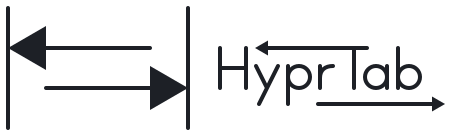

<h1 align="center">
  
</h1>

<p align="center">
  An Alt-Tab style window switcher for Hyprland, built with Qt6/QML
</p>

<p align="center">
  
  
  
</p>

```console
$ hyprtab list
0	0x5588a1b2c3d0	kitty	nag@desktop: ~
1	0x5588a1c04e10	firefox	GitHub - nagnagi/hyprtab
2	0x5588a1d55f20	org.telegram.desktop	Telegram
```

## Installation

You need Hyprland 0.57 or later, Qt6 (Quick/QML), CMake, and a C++20 compiler.

### From the AUR

```sh
paru -S hyprtab
```

### Using the installer script

```sh
git clone https://github.com/nagnagi/hyprtab.git
cd hyprtab
./install.sh
```

`install.sh` checks the dependencies, builds the binary, installs it to
`~/.local/bin/hyprtab`, and creates a systemd user service (left disabled by default).
To start it at login:

```sh
systemctl --user enable --now hyprtab.service
```

### Building from source

```sh
cmake -S . -B build -DCMAKE_BUILD_TYPE=Release
cmake --build build -j"$(nproc)"
# build/hyprtab is the resulting binary; put it on your PATH or invoke it by full path
```

## Features

- Shows the MRU (most-recently-used) window list as a compact panel centered on the focused monitor (default 920x212), not a full-screen overlay
- Keyboard-driven: hold Alt, press Tab to cycle, release Alt (or press Enter) to switch
- Mouse support: click a card to select and commit
- Live refresh while open (every 500 ms) without flicker; the selection is preserved by window address
- Auto-cancel: clicking outside the panel or losing focus for over a second closes it without switching
- Window icons resolved from the icon theme, `.desktop` `Icon=` entries, or direct icon-directory lookup
- The switcher's own window and windows on special workspaces are excluded from the list
- Focus switching via `hyprctl dispatch focuswindow`, with a fallback for the Lua-based `hyprctl` of Hyprland >= 0.57
- IPC over a Unix socket at `$XDG_RUNTIME_DIR/hyprtab.sock`

## Usage

Run the GUI process in the background (no arguments), or via the systemd user service:

```sh
hyprtab &
```

Then send commands from the CLI (`hyprtab <command>`):

| Command | Action |
|---|---|
| `show` | Show the list (second MRU entry preselected) |
| `next` / `prev` | Show if hidden, then move the selection forward/backward |
| `select <index>` | Select the entry at the given position |
| `commit` | Focus the selected window and close |
| `cancel` / `hide` | Close without changing focus |
| `activate <address>` | Focus a window directly, bypassing the GUI |
| `list` | Print the MRU-ordered list as TSV (debug) |
| `refresh` | Re-fetch the window list |
| `ping` | Health check (replies `pong`) |

### Hyprland configuration

Add the following to `~/.config/hypr/hyprland.lua`:

```lua
-- Start the GUI at session login
hl.on("hyprland.start", function()
  hl.exec_cmd("hyprtab")
end)

-- Open the switcher with Alt+Tab and cycle with Tab
hl.bind("ALT + Tab",         hl.dsp.exec_cmd("hyprtab next"), { repeating = true })
hl.bind("ALT + SHIFT + Tab", hl.dsp.exec_cmd("hyprtab prev"), { repeating = true })
hl.bind("ALT + Return",      hl.dsp.exec_cmd("hyprtab commit"))
hl.bind("ALT + Escape",      hl.dsp.exec_cmd("hyprtab cancel"))
```

While the overlay has focus, releasing the Alt key is detected and commits the current
selection, so a quick Alt+Tab tap switches immediately. Alternatively, use a submap:

```lua
hl.bind("ALT + Tab", hl.dsp.submap("hyprtab"))

hl.define_submap("hyprtab", function()
  hl.bind("Tab",         hl.dsp.exec_cmd("hyprtab next"))
  hl.bind("SHIFT + Tab", hl.dsp.exec_cmd("hyprtab prev"))
  hl.bind("Return",      hl.dsp.exec_cmd("hyprtab commit"))
  hl.bind("Escape",      hl.dsp.exec_cmd("hyprtab cancel"))
  -- commit on release of any key (the old "bind = , release, ...")
  hl.bind("catchall",    hl.dsp.exec_cmd("hyprtab commit"), { release = true })
end)
```

To pin the panel size in addition to float/center (applied automatically on show), add:

```lua
hl.window_rule({ match = { class = "^(hyprtab)$" }, float  = true })
hl.window_rule({ match = { class = "^(hyprtab)$" }, center = true })
hl.window_rule({ match = { class = "^(hyprtab)$" }, size   = "920 212" })
```

## License

[MIT License](LICENSE)

## Contributing

Issues and pull requests are welcome at <https://github.com/nagnagi/hyprtab>.
Before you open a pull request, make sure the project builds cleanly and the switcher
still works on your Hyprland session:

```sh
cmake -S . -B build -DCMAKE_BUILD_TYPE=Release
cmake --build build -j"$(nproc)"
./build/hyprtab ping   # -> pong
```
